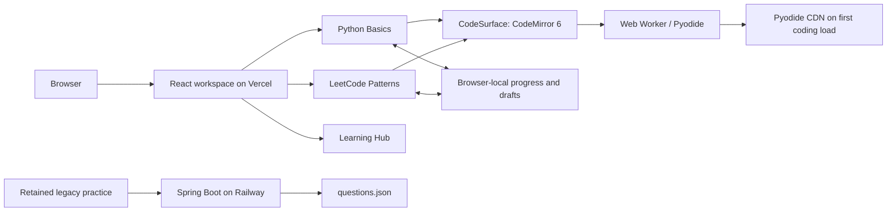

# SyntaxLab architecture

Current documentation: November 2, 2026. The three-section workspace shipped
October 29; the Graphite release adds the new dark theme and visual refinements.
See [release status](docs/release-status.md) for exact deployment evidence.

## System overview

SyntaxLab is a React 19/Vite single-page app hosted on Vercel. Python executes
inside the browser through Pyodide, not on the Java/Spring Boot API. The current
learning workspace bundles its curriculum with the frontend. The retained
legacy practice implementation uses the API's JSON question bank.

The diagram shows application responsibilities, not browser isolation from all
network access. Pyodide runs under browser permissions; its Python code can use
browser-provided network facilities. It also has a virtual filesystem. Browser
execution must not be described as a guarantee of no network or file operations.

## Navigation and content

| Route | Section | Content and execution |
| --- | --- | --- |
| `/` or `/#practice` | LeetCode Patterns | 75 questions, 162 graded parts; bundled curriculum and browser Python |
| `/#python` | Python Basics | 98 core drills, six optional projects; bundled curriculum and browser Python |
| `/#learn` | Learning Hub | 21 topics, 15 pattern groups; no editor, Python runtime or question API needed |
| `/#interview` | Learning Hub alias | Old links remain usable; Interview Prep source is archived |

`frontend/src/pages/SitePage.jsx` selects sections by URL fragment. Sections are
lazy-loaded; visited panels stay mounted to preserve editing state. Per-section
error boundaries keep navigation available if one panel fails. Hash routes work
on static hosting without a server router.

Active workspace components, the runtime curriculum and learning reference live
under `frontend/mockups/python-path/`. Despite the historical directory name,
these modules are imported by the normal production application through the
`@practice` alias. `archives/interview-prep/` preserves the older authored content
and manifest; it is not a separate deployed product.

The header's **Rapid fire** button opens `RapidFireMode.jsx` as a large focus
window over the dimmed site (Esc or Exit closes it). It runs timed reps from
`content/rapidFire.js`: 20 concepts, three reps each, grouped into three levels
plus a 60-rep full run. Every rep is added to one growing program and checked
through the same worker runner; later levels start from the earlier levels'
program. Data bubbles show each variable's value from authored `data` fields,
which content checks verify against real Python; each rep also shows a one-line
Python tip about the syntax it practices. A correct rep pulses a green border around
the whole window for a quarter second before the next rep appears; a wrong one shows a red
border and a short shake (a color fade only under reduced motion). Questions mark code with backticks, which render as code chips
(`RapidFireTask.jsx`), so variable names never read as English words. Data
bubbles sit in one column per value type, newest first (`RapidFireDataBank.jsx`). The clock can be paused or
hidden. Finished times per level stay in this browser under `synlab_rapid_fire_v1`.
On phones the typing area moves into the same code drawer the practice pages use
(below), with symbol keys and a visible Submit button; its **Reset code panel** control sits
in the Rapid Fire header.

## Practice feedback and pass flow

`runner.py` grades checks in order. When a check fails it also reports `expected` and `got`
(value text and type) if they can be known for certain: from `_expect` mismatches in
`content/structures.py`, or from a single `assert <name> == <literal>` whose left side is only
names, attributes and subscripts (so reading it again never reruns learner code). Otherwise
only the message is shown; nothing is guessed.

`FeedbackPanel.jsx` leads with the first failed check (the root cause), shows Expected and
"You wrote" side by side as small bubbles (`ValueComparison.jsx`), then the exercise's
**Watch for** tip (the Basics pitfall, or the pattern's watch-for on LeetCode Patterns), then
the full check list. Failed checks use a theme-aware tone (#8a4b08 on light, the theme's
warning tone on dark; both at least 4.5:1) and a ✕ mark.

The task sentence leads **Your task** at 17px with code chips (`TaskText.jsx` only chips calls,
snake_case or dotted names and True/False/None). Part, variation and order controls share
one quiet line under it, and the original LeetCode problem follows the task card. A
**See worked example** link opens the matching Learning Hub topic or pattern
(`learning/hubLink.js`) when a mapping exists. The explanation card reads **Hint** until the
exercise's first run, then **Why this works**. Basics numbers each topic and skill once;
variations are listed under their skill instead of as new numbered questions. First
variations of single-function "Write name(args)" tasks start from a signature stub
(`content/lesson.js`), except when the signature has default values.

After a pass, an inline pass bar replaces the editor footer (it never covers the code):
"Passed · N/N checks", the exercise's reflection line and a focused Next button. Tapping or
clicking the code then launches it: `CodeSurface`'s `characterBoxes()` reports every visible
character's screen box, and `codeLaunch.js` animates each as its own piece (Web Animations,
about 0.8s, a short vibration on touch devices) before advancing. Reduced motion uses a quick
fade. Next and Ctrl+Shift+Enter still advance immediately; launching never grants credit.
Desktop shows "Ctrl+Enter to run" beside Run code.

A small streak (`streakStore.js`, `synlab_first_try_streak_v1`) counts consecutive first-try
passes: passes with no earlier miss, revealed solution or reloaded answer on that visit. A
miss quietly resets it to zero; other passes leave it unchanged. There are no points or
leaderboards.

## Running and grading Python

`CodeSurface.jsx` (CodeMirror 6) supplies editor text and virtual files. `usePracticeRunner.js` sends the
exercise/files to `python.worker.js`; Pyodide evaluates them using `runner.py`.
Results return by message and update the visible feedback/progress. Startup is
bounded at 45 seconds and a run at five seconds. Stop terminates and recreates
the worker while preserving the draft. Request identities reject stale results.

Authored tests establish the exercise contract; they are not the complete
LeetCode judge, proof of optimal complexity, or a general security sandbox audit.
The backend has no Python execution endpoint. Initial coding use requires a CDN
download for Pyodide.

## Editor and phone layout

Every live editor goes through one wrapper, `CodeSurface.jsx`, built on CodeMirror 6
([ADR 0001](docs/decisions/0001-codemirror-editor.md)). Pages never import an editor
library directly, so the editor can change again without touching them. It provides:

- Python highlighting
- built-in names colored like keywords (`pythonBuiltins.js`)
- Monaco-style indent guides
- 4-space indent and auto-indent after a colon
- page-specific key bindings
- an `insertText` handle for the symbol keys

Colors come from the one `editorPalette` in `editorSupport.js`. Moving from Monaco
cut the largest production JS chunk from about 3.7 MB to about 0.5 MB.

The site theme follows the OS `prefers-color-scheme` until the learner picks one with the
header toggle; that choice is kept in `synlab_theme_v1`. Graphite is the normal dark mode,
and explicit palette query parameters (`?dark=`) still force dark for color comparisons.
Practice editors follow the site theme. An editor-only override (Match site / Light / Dark)
lives in the editor toolbar's **Editor options** (⋯) menu and is shared by every mounted
practice editor (`editorThemeStore.js`). Rapid Fire's editor is always dark.

Under 900px wide (`PHONE_LAYOUT_QUERY`), `StudyWorkspace` renders
`PhoneStudyWorkspace`:

- **The page:** the question reads as a normal page.
- **Questions:** the list opens from a **Questions** button.
- **The drawer:** the editor, feedback and footer sit in `CodeDrawer`.
  - Drag the handle to any height inside a safe range: the handle always stays fully
    above the bottom safe area (`env(safe-area-inset-bottom)`) and browser bars, and at
    least 48px below the top of the visible screen (at most 90% of it). Saved heights
    are clamped into that range on every screen size; the drawer is never auto-reset.
    Tapping the handle folds or reopens it.
  - **Lock** freezes the height and stays on the drawer.
  - **Reset code panel** (in the page header next to **Questions**, and in the Rapid
    Fire header) restores the default height and unlocks it. It is outside the drawer
    so it never sits beside the editor's own Reset code button.
  - A one-line task summary is pinned at the top of the drawer; tap it to read the
    whole task without folding the drawer.
  - It follows the visual viewport, so it stays above the phone keyboard and
    browser bars. On phones the active section panel stacks above the section tabs,
    so a tall drawer never slides under them.
- **Symbol keys:** `SymbolKeys.jsx` inserts the symbols phone keyboards hide.

Drawer height and lock state are kept per browser in `synlab_code_drawer_v1` for
practice and `synlab_rapid_fire_drawer_v1` for Rapid Fire. Desktop layouts are
unchanged. The retained legacy `MainPage` / `CodeEditor.jsx`, the archived interview
practice and the `RedesignDraft` mockup still use Monaco and are not routed in the
live app. The rollout record is the
[mobile code drawer plan](docs/mobile-code-drawer-plan.md).

## Persistence and completion

Basics and Patterns use `synlab_python_path_v1` with separate selections and a
shared save owner. Old exercise IDs are retained. Legacy `synlab_progress`,
`synlab_code` and `synlab_interview_recall_v1` records are preserved separately.

Passing a warm-up does not complete its parent question. Editing a passed answer
requires another pass; revealed/corrected work is tracked as assisted. Launching
passed code never grants practice credit. Browser checks cover backup replacement during
runs, reload and cross-section drafts.

Storage is specific to a browser profile and origin. Supported export/import
transfers practice data; no account, automatic cross-device sync or server backup
is provided. Clearing browser data can lose progress. Sentry is initialized when
configured; browser-local practice storage is not a claim that the site makes no
third-party requests or emits no diagnostics.

## API and deployment

The Spring Boot backend serves the retained question bank through
`GET /api/questions`; it holds no user progress and receives no code payload from
the current practice runner. It validates/caches its authored JSON, returns typed
responses and provides OpenAPI documentation where enabled. JSON remains adequate
for this developer-authored content; no PostgreSQL migration is implemented.

Feature PRs target `develop`; production releases promote `develop` to `main`.
GitHub Actions deploys the frontend to Vercel and the backend using Railway's CLI.
Both workflows currently name the same Railway service, `syntaxLab`; do not infer
separate isolated backend environments solely from the workflow names. Confirm
Railway environment configuration before changing backend behavior.

Production deployment records and source revision are in
[release status](docs/release-status.md). A green deploy job establishes that the
workflow completed, not that every user interaction works. Release checks should
exercise the deployed app and record the tested revision and scope.

## Verification and tradeoffs

The [workspace guide](frontend/mockups/python-path/README.md) lists content,
Node and browser checks. The [curriculum audit](docs/curriculum-audit.md) records
dated results. Native Python checks validate authored answers; browser checks
exercise compiled Pyodide, navigation, grading, persistence and responsive themes.
No full accessibility audit, user-learning study or production-scale load result
is claimed.

Browser execution avoids operating a server code-execution service, at the cost
of initial download time and client resource use. Static content simplifies
hosting but requires a frontend release to update the active curriculum. Local
storage removes sign-up friction but provides no automatic recovery across devices.
