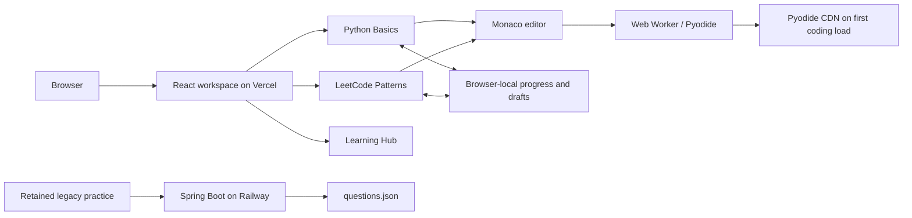

# SyntaxLab architecture

Current documentation: November 2, 2026. The three-section workspace shipped
October 29; the Graphite release adds the new dark theme and visual refinements.
See [release status](docs/release-status.md) for exact deployment evidence.

## System overview

SyntaxLab is a React 19/Vite single-page app hosted on Vercel. Python executes
inside the browser through Pyodide, not on the Java/Spring Boot API. The current
learning workspace bundles its curriculum with the frontend. The retained
legacy practice implementation uses the API's JSON question bank.

The diagram shows application responsibilities, not browser isolation from all
network access. Pyodide runs under browser permissions; its Python code can use
browser-provided network facilities. It also has a virtual filesystem. Browser
execution must not be described as a guarantee of no network or file operations.

## Navigation and content

| Route | Section | Content and execution |
| --- | --- | --- |
| `/` or `/#practice` | LeetCode Patterns | 75 questions, 162 graded parts; bundled curriculum and browser Python |
| `/#python` | Python Basics | 98 core drills, six optional projects; bundled curriculum and browser Python |
| `/#learn` | Learning Hub | 21 topics, 15 pattern groups; no editor, Python runtime or question API needed |
| `/#interview` | Learning Hub alias | Old links remain usable; Interview Prep source is archived |

`frontend/src/pages/SitePage.jsx` selects sections by URL fragment. Sections are
lazy-loaded; visited panels stay mounted to preserve editing state. Per-section
error boundaries keep navigation available if one panel fails. Hash routes work
on static hosting without a server router.

Active workspace components, the runtime curriculum and learning reference live
under `frontend/mockups/python-path/`. Despite the historical directory name,
these modules are imported by the normal production application through the
`@practice` alias. `archives/interview-prep/` preserves the older authored content
and manifest; it is not a separate deployed product.

## Running and grading Python

Monaco supplies editor text and virtual files. `usePracticeRunner.js` sends the
exercise/files to `python.worker.js`; Pyodide evaluates them using `runner.py`.
Results return by message and update the visible feedback/progress. Startup is
bounded at 45 seconds and a run at five seconds. Stop terminates and recreates
the worker while preserving the draft. Request identities reject stale results.

Authored tests establish the exercise contract; they are not the complete
LeetCode judge, proof of optimal complexity, or a general security sandbox audit.
The backend has no Python execution endpoint. Initial coding use requires a CDN
download, and the large Monaco bundle remains a first-load limitation.

The editor theme is shared across mounted editor instances. The site starts in
light mode. The Graphite release uses Graphite for normal dark mode; explicit palette
query parameters retain earlier color comparisons. Editor and site theme controls
remain independent.

## Persistence and completion

Basics and Patterns use `synlab_python_path_v1` with separate selections and a
shared save owner. Old exercise IDs are retained. Legacy `synlab_progress`,
`synlab_code` and `synlab_interview_recall_v1` records are preserved separately.

Passing a warm-up does not complete its parent question. Editing a passed answer
requires another pass; revealed/corrected work is tracked as assisted. Celebration
taps never grant practice credit. Browser checks cover backup replacement during
runs, reload and cross-section drafts.

Storage is specific to a browser profile and origin. Supported export/import
transfers practice data; no account, automatic cross-device sync or server backup
is provided. Clearing browser data can lose progress. Sentry is initialized when
configured; browser-local practice storage is not a claim that the site makes no
third-party requests or emits no diagnostics.

## API and deployment

The Spring Boot backend serves the retained question bank through
`GET /api/questions`; it holds no user progress and receives no code payload from
the current practice runner. It validates/caches its authored JSON, returns typed
responses and provides OpenAPI documentation where enabled. JSON remains adequate
for this developer-authored content; no PostgreSQL migration is implemented.

Feature PRs target `develop`; production releases promote `develop` to `main`.
GitHub Actions deploys the frontend to Vercel and the backend using Railway's CLI.
Both workflows currently name the same Railway service, `syntaxLab`; do not infer
separate isolated backend environments solely from the workflow names. Confirm
Railway environment configuration before changing backend behavior.

Production deployment records and source revision are in
[release status](docs/release-status.md). A green deploy job establishes that the
workflow completed, not that every user interaction works. Release checks should
exercise the deployed app and record the tested revision and scope.

## Verification and tradeoffs

The [workspace guide](frontend/mockups/python-path/README.md) lists content,
Node and browser checks. The [curriculum audit](docs/curriculum-audit.md) records
dated results. Native Python checks validate authored answers; browser checks
exercise compiled Pyodide, navigation, grading, persistence and responsive themes.
No full accessibility audit, user-learning study or production-scale load result
is claimed.

Browser execution avoids operating a server code-execution service, at the cost
of initial download time and client resource use. Static content simplifies
hosting but requires a frontend release to update the active curriculum. Local
storage removes sign-up friction but provides no automatic recovery across devices.
