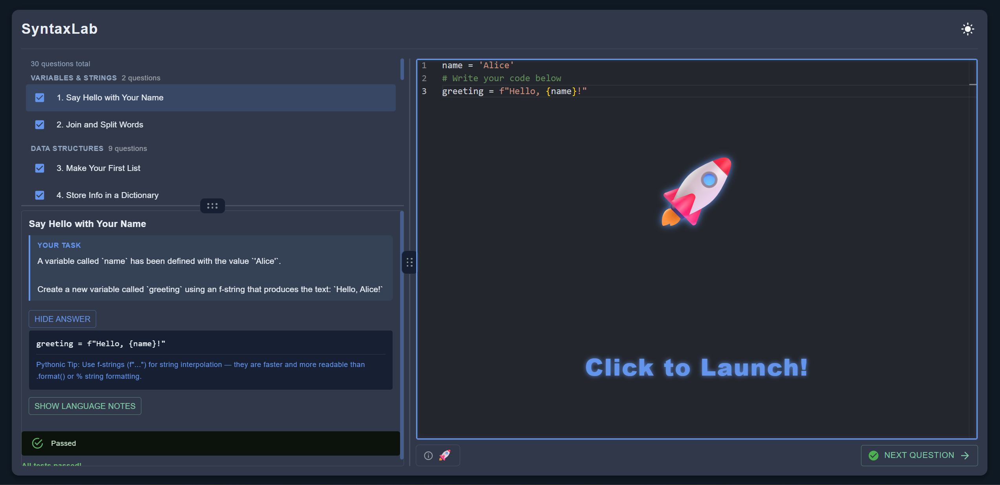
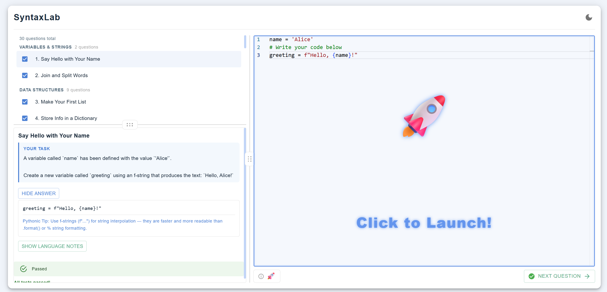

# SyntaxLab

An online IDE for learning Python syntax through simple, practical exercises.
Designed for beginners who want to learn idiomatic Python fast.

🌐 **Live Demo:** [syntaxlab.work](https://syntaxlab.work)


---

## Screenshots

| Dark Mode | Light Mode |
|---|---|
|  |  |

---

## Features

The frontend now includes three sections in the same application build:

- **Python Basics** (`/#python`): 98 core syntax drills, with six separately marked
  optional projects. Each topic has lettered skills and numbered variations.
- **LeetCode Patterns** (`/` or `/#practice`): exactly 75 questions with official
  numbers/titles, ordered pattern groups, original-problem context, preparation
  steps and the full problem. Passing a warm-up does not complete its question.
- **Learning Hub** (`/#learn`): 21 concise Python topics with examples and
  outputs, visuals for 15 pattern groups, Python uses and useful quirks.

The approved floating-island layout is now the default, with light mode initially.
Skip lives beside Run; after the current code passes it becomes Next. Explanations
and optional code solutions are separate. File creation appears only where useful.
See the [curriculum review and release checks](docs/curriculum-audit.md).

Basics and pattern work share the existing browser storage key with separate
selections and one save owner; original practice progress remains separate.
Learning Hub visits load neither the questions API nor Python/editor runtime.
Interview Prep is saved in the [archive](archives/interview-prep/README.md) for
a future separate site. Existing browser recall data is preserved; old
`/#interview` links open Learning Hub. See the [Hub guide](docs/learning-hub.md),
[study plan and release handoff](docs/study-workflow-plan.md),
[printable reference](docs/interview-reference.md) and
[workspace guide](frontend/mockups/python-path/README.md). These local changes
require review and publication before they describe the live site.

The earlier 30-question practice implementation remains in source for reference;
its storage is preserved. The following list describes that historical version:

- **30 exercises** across 7 topic groups: Variables & Strings, Data Structures, Control Flow, Functions & Pythonic Style, Operators, Object-Oriented, Algorithms & Patterns
- **Python runs entirely in the browser** via Pyodide (WebAssembly) — no server-side code execution
- **Monaco Editor** (the same editor that powers VS Code)
- **Instant feedback** — pass/fail on every test assertion
- **Progress tracking** — completion state saved to localStorage, persists on refresh
- **Pythonic tips** and concept summaries on every question
- **Show Answer** — reveals the correct solution when stuck
- **Dark / light mode** toggle
- **Draggable split panels** — resize the question list, prompt, and editor to your preference
- **Error tracking** via Sentry

---

## Tech Stack

| Layer | Technology |
|---|---|
| Frontend | React 19, Vite |
| UI Components | Material UI (MUI) |
| Code Editor | Monaco Editor |
| Python Execution | Pyodide (WebAssembly — runs entirely in the browser) |
| Backend | Java 21, Spring Boot 3.5, Maven |
| Question Storage | JSON (PostgreSQL planned) |
| Containerization | Docker |
| Frontend Hosting | Vercel |
| Backend Hosting | Railway |
| CI/CD | GitHub Actions |
| Error Tracking | Sentry |

---

## Local Setup

### Prerequisites
- Node.js 18+
- Java 21
- Maven (or use the included `./mvnw` wrapper)

### 1. Clone the repo
```bash
git clone https://github.com/nandohtorres/syntaxLab.git
cd syntaxLab
```

### 2. Run the backend
```bash
cd backend
./mvnw spring-boot:run
```
Backend runs at `http://localhost:8080`. Wait for `Started SynlabApplication` before starting the frontend.

### 3. Run the frontend
```bash
cd frontend
npm install
npm run dev
```
Frontend runs at `http://localhost:3000`

---

## Environment Variables

Copy the example file and fill in your values:
```bash
cp frontend/.env.example frontend/.env.local
```

See `frontend/.env.example` for all required variables.

---

## Project Structure

```
syntaxLab/
├── frontend/         # React + Vite app
│   └── src/
│       ├── components/   # Reusable UI components
│       ├── context/      # React context providers
│       ├── hooks/        # Custom React hooks
│       ├── pages/        # Top-level page components
│       └── utils/        # Pure helper functions
└── backend/          # Spring Boot REST API
    └── src/main/
        ├── java/com/synlab/backend/
        │   ├── config/       # Spring configuration + rate limiting
        │   ├── controller/   # REST controllers
        │   ├── exception/    # Global error handling
        │   ├── model/        # Java records
        │   └── service/      # Business logic
        └── resources/
            └── questions.json  # Question bank (30 questions)
```

---

## API Docs

Swagger UI is available on staging (`develop` branch) at `/swagger-ui.html`. Disabled in production.

---

## Architecture

Python code runs **entirely in the browser** via Pyodide. The backend never receives or executes user-submitted code — it only serves questions via `GET /api/questions`. See [ARCHITECTURE.md](./ARCHITECTURE.md) for full details.

---

## License

[MIT](./LICENSE)
